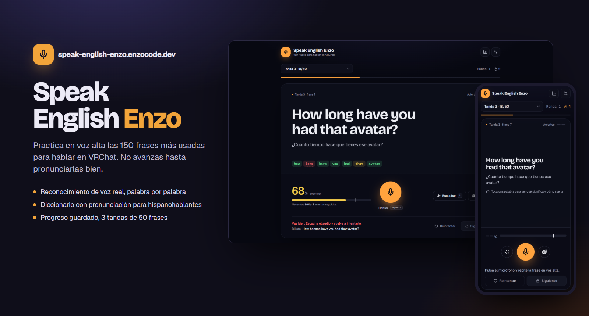
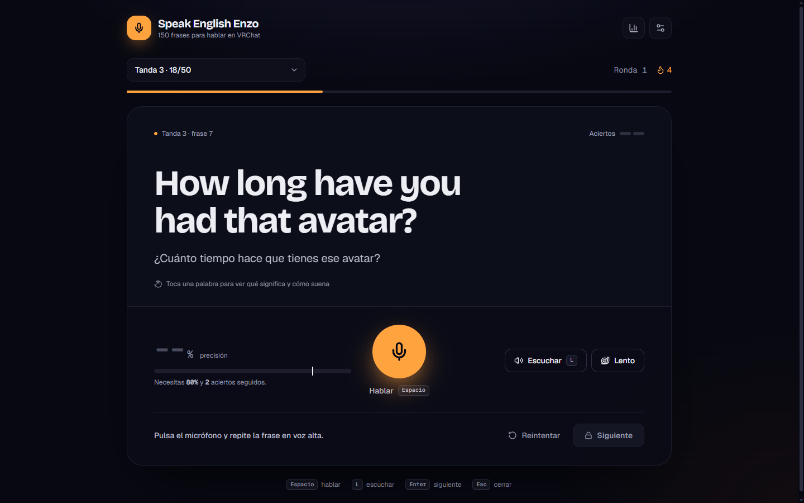
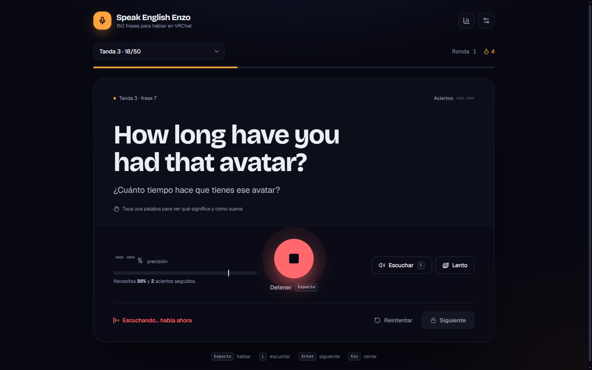
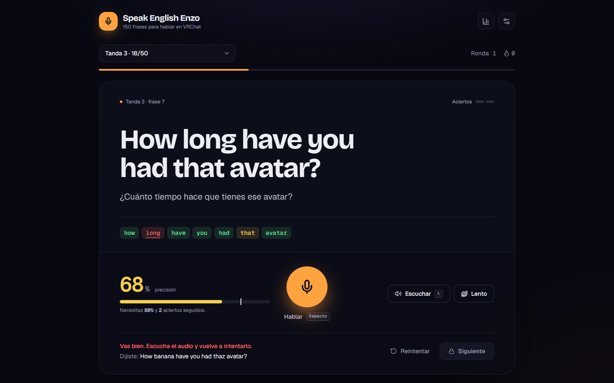
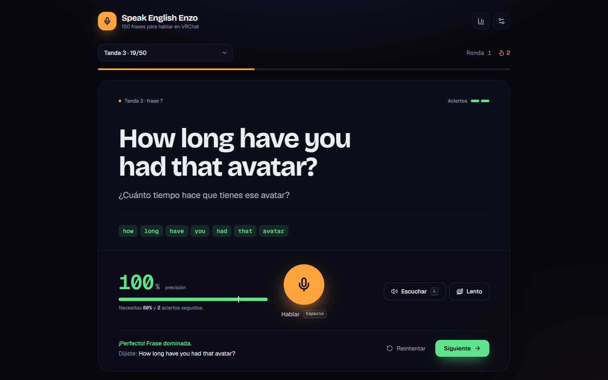
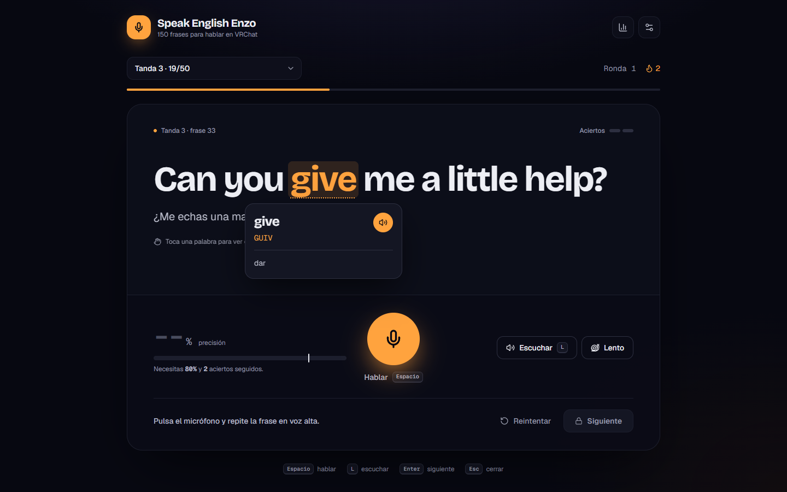
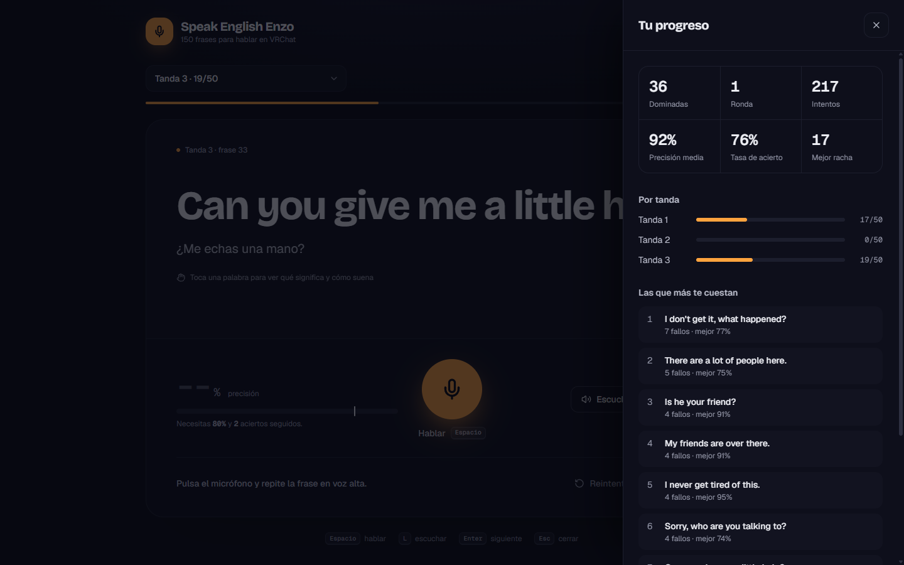
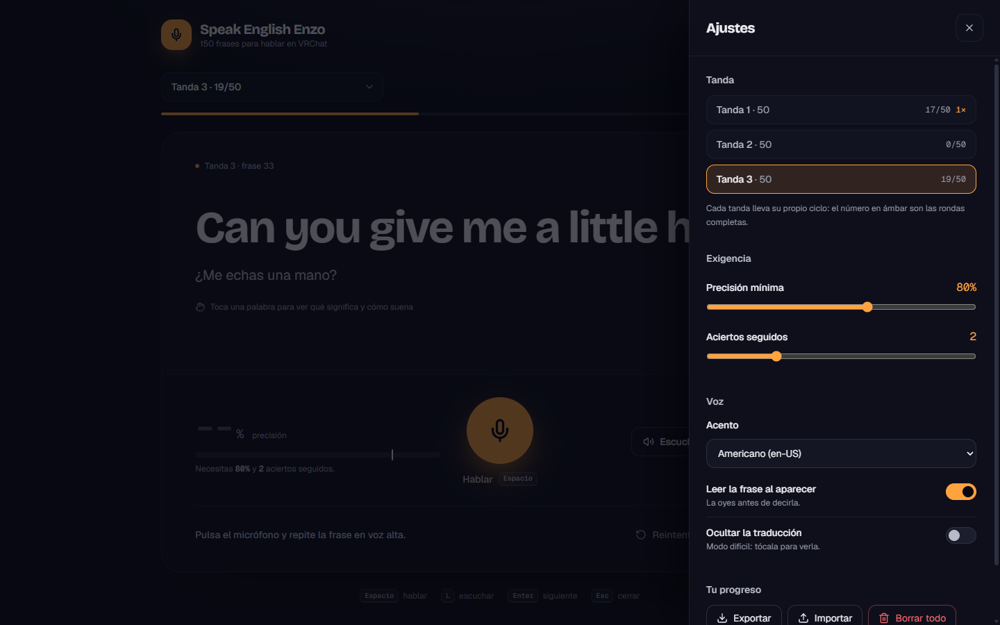
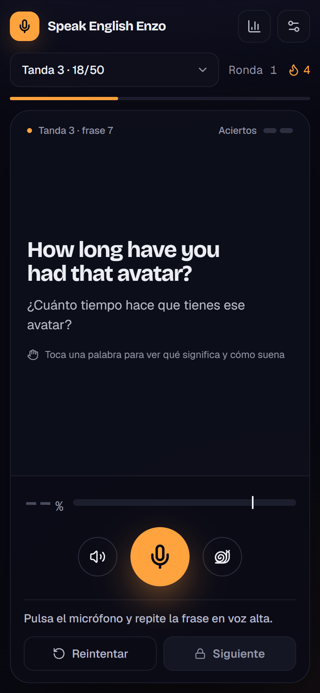
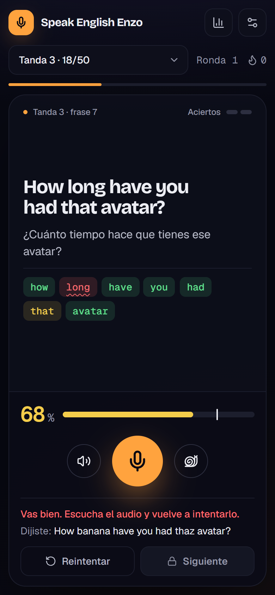

<div align="center">



# 🎙️ Speak English Enzo

**Practica en voz alta 500 frases: VRChat y entrevistas de programación.**<br>
Reconocimiento de voz real: no pasas a la siguiente frase hasta que la pronuncias bien.

[](https://speak-english-enzo.enzocode.dev)


</div>

---

## 📚 Índice

- [Qué es](#-qué-es)
- [Capturas](#-capturas)
- [Guía de uso](#-guía-de-uso)
- [Atajos de teclado](#️-atajos-de-teclado)
- [Ajustes](#️-ajustes)
- [Cómo se puntúa](#-cómo-se-puntúa)
- [Problemas frecuentes](#-problemas-frecuentes)
- [Desarrollo](#️-desarrollo)
- [Estructura del proyecto](#️-estructura-del-proyecto)
- [Despliegue](#-despliegue)

---

## ✨ Qué es

Speak English Enzo es una app web para **entrenar la pronunciación** en dos contextos:
conversación informal en VRChat y entrevistas de trabajo en programación. Hay preguntas,
respuestas y explicaciones cortas, con traducción al español y diccionario tocable.
Las respuestas de entrevistas son **ejemplos de práctica**: adáptalas a tu experiencia real.

| | |
|---|---|
| 🎯 **500 frases** | Diez tandas de 50: **250 de VRChat** con su vocabulario de 200 palabras y **250 de entrevistas** con vocabulario profesional y técnico ampliado. |
| 🎤 **Voz real** | El navegador te escucha y la app puntúa cada palabra de 0 a 100 %. |
| 🔒 **Sin trampas** | La frase se desbloquea solo al superar el **70 % dos veces seguidas**. |
| 📖 **Diccionario** | Toca cualquier palabra: significado, pronunciación escrita para hispanohablantes y audio. |
| 🔁 **Sin repeticiones** | Una frase dominada no vuelve a salir hasta terminar el ciclo de su tanda. |
| 💾 **Progreso guardado** | Todo se queda en tu navegador; puedes exportarlo e importarlo. |
| 📱 **Móvil** | Diseño adaptado que cabe en la pantalla sin hacer scroll. |

---

## 📸 Capturas

<table>
  <tr>
    <td width="50%"></td>
    <td width="50%"></td>
  </tr>
  <tr>
    <td align="center"><b>Pantalla principal</b><br><sub>La frase, su traducción y la consola de práctica.</sub></td>
    <td align="center"><b>Escuchando</b><br><sub>El micro se pone rojo mientras hablas.</sub></td>
  </tr>
  <tr>
    <td></td>
    <td></td>
  </tr>
  <tr>
    <td align="center"><b>Resultado palabra por palabra</b><br><sub>Verde bien, amarillo regular, rojo mal.</sub></td>
    <td align="center"><b>Frase dominada</b><br><sub>Dos aciertos seguidos desbloquean <i>Siguiente</i>.</sub></td>
  </tr>
  <tr>
    <td></td>
    <td></td>
  </tr>
  <tr>
    <td align="center"><b>Diccionario</b><br><sub>Significado, pronunciación y audio de cada palabra.</sub></td>
    <td align="center"><b>Tu progreso</b><br><sub>Dominadas, precisión, rachas y las frases que más cuestan.</sub></td>
  </tr>
</table>

<table>
  <tr>
    <td width="34%"></td>
    <td width="33%" align="center"></td>
    <td width="33%" align="center"></td>
  </tr>
  <tr>
    <td align="center"><b>Ajustes</b></td>
    <td align="center"><b>Móvil</b></td>
    <td align="center"><b>Móvil con resultado</b></td>
  </tr>
</table>

---

## 🧭 Guía de uso

> [!IMPORTANT]
> Usa **Google Chrome** o **Microsoft Edge** (en ordenador o Android). Firefox y Safari no
> soportan el reconocimiento de voz del navegador. La primera vez el navegador te pedirá
> **permiso para usar el micrófono**: acéptalo.

### 1. Elige una tanda

El selector agrupa las tandas en **VRChat** (1–5) y **Entrevistas de programación** (6–10).
Cada tanda tiene 50 frases y conserva su propio progreso y sus rondas. Por defecto se abre
**Tanda 6 · Perfil**; la actualización la activa una sola vez, sin borrar lo practicado.
Después se respeta la tanda que elijas. La barra naranja muestra tu avance en la tanda actual.

| Tanda | Contenido |
|---|---|
| 1–5 | Conversación en VRChat: preguntas, reacciones, micro, avatares y planes |
| 6 · Perfil | Presentarte, experiencia, motivación, fortalezas y objetivos |
| 7 · Equipo | Proyectos, colaboración, decisiones, feedback y situaciones de trabajo |
| 8 · Código | Aclarar requisitos, explicar algoritmos, complejidad y casos límite |
| 9 · Web | JavaScript, TypeScript, React, accesibilidad, APIs y PostgreSQL |
| 10 · Sistemas | Arquitectura, pruebas, producción, uso responsable de IA y preguntas al equipo |

El temario de entrevistas se revisó el **9 de noviembre de 2026** con guías públicas de
Microsoft, Atlassian y Amazon (véase `docs/entrevistas.md`). Las frases son originales para
practicar inglés: no son preguntas filtradas ni un ranking de frecuencia. El uso de IA en una
entrevista depende de las reglas del proceso; pregunta antes de usarla.

### 2. Escucha la frase

La frase aparece en grande con su traducción debajo y **se lee sola** al aparecer.

- **🔊 Escuchar** (o la tecla `L`) la repite a velocidad normal.
- **🐢 Lento** la repite despacio para fijarte en cada sonido.

### 3. Toca las palabras que no conozcas

Toca cualquier palabra y aparece un recuadro con:

- el **significado** en español,
- **cómo se pronuncia**, escrito para hispanohablantes con la sílaba fuerte en mayúsculas
  (`avatar` → `Á-va-tar`, `give` → `GUIV`),
- el botón 🔊 para oírla otra vez (además suena sola al tocarla).

### 4. Pulsa el micrófono y repítela

Pulsa el botón naranja (o `Espacio`). Espera a ver **«Escuchando… habla ahora»** y di la frase
completa. Cuando te callas un momento, la app deja de escuchar sola; también puedes pulsar
**Detener**.

> [!TIP]
> Si empiezas a hablar antes de que aparezca «Escuchando…», se pierde el principio de la frase y
> la app te avisará con *«Solo escuché X de Y palabras»*.

### 5. Revisa el resultado

- La **puntuación** (0–100 %) aparece con una barra; la rayita blanca marca el mínimo (70 %).
- Debajo de la frase ves **cada palabra coloreada**: 🟢 bien · 🟡 regular · 🔴 mal.
  Toca una palabra roja para oír cómo se dice.
- Los dos indicadores de **Aciertos** (arriba a la derecha) se llenan con cada intento bueno.

### 6. Domina la frase y pasa a la siguiente

Necesitas superar el mínimo **dos veces seguidas**. Si fallas, los aciertos vuelven a cero.
Cuando la dominas, **Siguiente** se pone verde: púlsalo (o `Enter`).

La frase dominada no vuelve a salir hasta que completes todas las de la tanda. Al terminarlas
empieza la **ronda 2** con todas barajadas otra vez. Cada tanda lleva su propio contador de
rondas.

### 7. Mira tu progreso

El botón 📊 abre **Tu progreso**: frases dominadas, intentos, precisión media, tasa de acierto,
mejor racha, avance por tanda y el **top 10 de frases que más te cuestan**. La 🔥 de arriba es tu
racha actual de aciertos seguidos.

---

## ⌨️ Atajos de teclado

| Tecla | Acción |
|:---:|---|
| `Espacio` | Empezar / parar el micrófono |
| `L` | Escuchar la frase |
| `Enter` | Siguiente frase (si está desbloqueada) |
| `Esc` | Cerrar el recuadro de la palabra o el panel abierto |

---

## ⚙️ Ajustes

El botón ⚙️ abre el panel de ajustes:

| Ajuste | Qué hace | Por defecto |
|---|---|:---:|
| **Tanda** | Qué tanda practicar (lo mismo que el selector de arriba) | Tanda 6 · Perfil |
| **Precisión mínima** | Puntuación necesaria para que un intento cuente (50–100 %) | 70 % |
| **Aciertos seguidos** | Cuántas veces seguidas hay que decirla bien (1–5) | 2 |
| **Acento** | Voz y reconocimiento en inglés americano, británico, australiano o canadiense | en-US |
| **Leer la frase al aparecer** | Reproduce la frase automáticamente | Sí |
| **Ocultar la traducción** | Modo difícil: la traducción sale borrosa y se ve al tocarla | No |
| **Exportar / Importar** | Guarda tu progreso en un `.json` o lo recupera | — |
| **Borrar todo** | Empieza de cero (pide confirmación) | — |

> [!NOTE]
> El progreso se guarda **en el navegador y por dirección**: lo que practiques en
> `localhost:8082` no aparece en la web publicada, ni al revés. Para llevártelo, usa
> **Exportar** en un sitio e **Importar** en el otro.

---

## 🧮 Cómo se puntúa

1. **Normalización.** Lo que dijiste y la frase objetivo se pasan a minúsculas, sin puntuación,
   con las contracciones desplegadas (`I'm` → `i am`, `gonna` → `going to`), los números en
   letra y grafías equivalentes unificadas (`OK` → `okay`, `mike` → `mic`).
2. **Alineación palabra a palabra** (Needleman-Wunsch) para saber qué palabra de la frase
   corresponde a cada palabra dicha, aunque te saltes o añadas alguna.
   Las siglas técnicas conocidas admiten letras separadas (`A P I` → `API`, `S Q L` → `SQL`)
   solo cuando esa sigla aparece en la frase objetivo; no se perdonan letras diferentes.
3. **Crédito por palabra.** Solo cuenta entera si es exacta; una palabra parecida (mal
   pronunciada) recibe un 25 % y una distinta, nada.
4. **Similitud por caracteres** con una curva que solo suma cuando de verdad se parece.
5. **Penalización** de un 10 % por cada palabra de más (hasta un 30 %).

`puntuación = 80 % palabras + 20 % caracteres − palabras de más`

El reconocedor devuelve hasta **5 interpretaciones** de lo que dijiste; se puntúan todas y se
queda la mejor. En el móvil, además, se limpian los fragmentos repetidos que a veces devuelve
el reconocimiento continuo.

---

## 🩺 Problemas frecuentes

<details>
<summary><b>Dice «Sin reconocimiento de voz»</b></summary>

Tu navegador no tiene la Web Speech API. Abre la app en **Chrome** o **Edge**.
</details>

<details>
<summary><b>«El navegador bloqueó el micrófono»</b></summary>

Pulsa el icono del candado en la barra de direcciones → **Micrófono → Permitir** y recarga la
página.
</details>

<details>
<summary><b>«No escuché nada»</b></summary>

Comprueba que el micrófono correcto está seleccionado en el sistema, acércate y habla después de
ver «Escuchando…».
</details>

<details>
<summary><b>«Sin conexión»</b></summary>

El reconocimiento de voz de Chrome y Edge se procesa en la nube: necesitas internet.
</details>

<details>
<summary><b>No suena la frase</b></summary>

El navegador no deja reproducir audio hasta que tocas algo en la página. Pulsa **Escuchar** una
vez y a partir de ahí se leerá sola.
</details>

---

## 🛠️ Desarrollo

Requiere **Node.js 22.18 o superior**.

```bash
git clone https://github.com/EnzoCodeDev/speak-english-enzo.git
cd speak-english-enzo
npm install
npm run dev        # http://localhost:8082
```

| Script | Qué hace |
|---|---|
| `npm run dev` | Servidor de desarrollo en el puerto **8082** |
| `npm run build` | Export estático en `out/` |
| `npm run start` | Sirve `out/` en el puerto 8082 |
| `npm run lint` | ESLint |
| `npm run typecheck` | Comprobación de tipos |
| `npm run validate` | Valida las frases: duplicados, variedad, vocabulario y diccionario |
| `npm test` | Comprueba las 500 frases, puntuación, diccionario y migración sin perder progreso |

> [!WARNING]
> El puerto es fijo a propósito: el progreso va por origen, así que `localhost:8083` sería un
> progreso nuevo y vacío.

### Añadir o cambiar frases

1. Añade al final de `src/data/phrases.ts` (formato `[inglés, español, categoría]`). Cada 50
   frases forman una tanda. Las entrevistas viven en `src/data/interview-set-6.ts` a `10.ts`.
2. En **VRChat**, usa solo palabras de `src/data/palabras-conversacion.ts`. Las **entrevistas**
   pueden ampliar el vocabulario; cada módulo exporta también sus entradas nuevas de diccionario.
   Todas las palabras necesitan significado y pronunciación en `src/data/dictionary.ts`.
3. Ejecuta `npm run validate` hasta ver `*** TODO CORRECTO ***` y `npm test`.

> [!CAUTION]
> El progreso se guarda **por la posición** de cada frase. No reordenes ni reescribas frases
> existentes: añade las nuevas al final. Si hay que reescribirlas, sube `PHRASES_VERSION` en
> `src/lib/state.ts` para que el progreso antiguo se descarte limpiamente.

---

## 🗂️ Estructura del proyecto

```text
speak-english-enzo/
├── src/
│   ├── app/                    # layout, página, estilos globales (tema) e icono
│   ├── components/
│   │   ├── SpeakApp.tsx        # pantalla principal: frase, consola, micro y atajos
│   │   ├── Phrase.tsx          # frase con palabras tocables y resultado coloreado
│   │   ├── WordPopover.tsx     # recuadro del diccionario
│   │   ├── Panels.tsx          # paneles de Ajustes y Tu progreso
│   │   ├── ClientApp.tsx       # carga la app solo en el navegador
│   │   └── ui.tsx              # botones, panel lateral, interruptores, teclas
│   ├── data/
│   │   ├── phrases.ts          # las 500 frases y sus tandas/grupos
│   │   ├── interview-set-*.ts  # 250 frases de entrevistas y vocabulario nuevo
│   │   ├── dictionary.ts       # significado y pronunciación de cada palabra
│   │   └── palabras-conversacion.ts  # las 200 palabras permitidas en VRChat
│   └── lib/
│       ├── scoring.ts          # normalización, alineación y puntuación
│       ├── state.ts            # progreso, migraciones y cola sin repeticiones
│       ├── store.ts            # puente entre el estado y React
│       └── speech.ts           # reconocimiento y síntesis de voz
├── scripts/
│   ├── validar-frases.mts      # validador de las frases
│   └── deploy.sh               # despliegue al VPS
├── deploy/
│   ├── deploy.conf.example     # plantilla de la configuración (la real es local)
│   ├── site.caddy              # configuración de Caddy del sitio
│   └── smoke.txt               # URLs que deben responder tras desplegar
├── docs/
│   ├── screenshots/            # capturas de este README
│   └── banner.html             # fuente de la imagen de portada
├── Dockerfile                  # alternativa: build + Caddy en contenedor
└── Caddyfile.static            # Caddy del contenedor
```

---

## 🚀 Despliegue

Publicada en **https://speak-english-enzo.enzocode.dev**: un servidor Linux con **Caddy**, que sirve
el export estático y gestiona solo el certificado HTTPS de Let's Encrypt.

```bash
./scripts/deploy.sh            # valida, compila, sube una versión nueva y la activa
./scripts/deploy.sh status     # versión activa, versiones guardadas y estado de Caddy
./scripts/deploy.sh rollback   # vuelve a la versión anterior al instante
./scripts/deploy.sh setup      # prepara un servidor desde cero (instala Caddy y el sitio)
```

La configuración del servidor vive en `deploy/deploy.conf`, un archivo **local que no se sube
al repo** (está en `.gitignore`). Para crearlo:

```bash
cp deploy/deploy.conf.example deploy/deploy.conf   # y rellena HOST (alias SSH) y DOMAIN
```

El acceso al servidor va por un alias de `~/.ssh/config` con autenticación por clave: el repo no
contiene IPs, usuarios, claves ni contraseñas.

<details>
<summary><b>Cómo queda el servidor</b></summary>

```text
/etc/caddy/Caddyfile              # bloque global + import /etc/caddy/sites/*.caddy
/etc/caddy/sites/<sitio>.caddy    # copia de deploy/site.caddy
/var/www/<sitio>/
├── releases/<fecha>-<commit>/    # cada despliegue (se guardan las 5 últimas)
└── current -> releases/<...>     # la versión que sirve Caddy
```

Cada sitio tiene su propio archivo en `/etc/caddy/sites/`, así que el servidor puede alojar más
proyectos sin que se pisen.
</details>

También hay un `Dockerfile` (compila con Node y sirve con Caddy sin root) por si se prefiere
desplegar en contenedor: `docker compose up -d --build`.

---

<div align="center">
<sub>Hecho por <a href="https://github.com/EnzoCodeDev">EnzoCodeDev</a> para practicar inglés en conversaciones y entrevistas 🎙️</sub>
</div>
